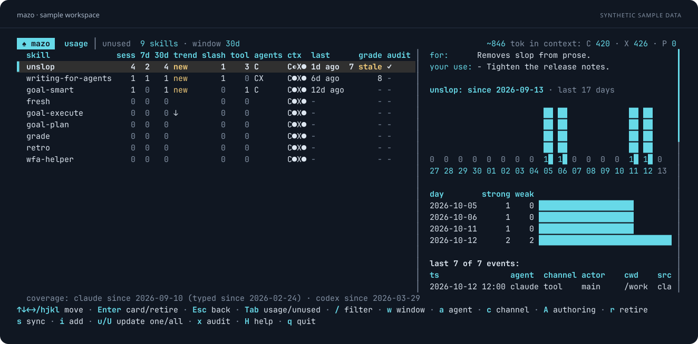

<p align="center">
  <picture>
    <source media="(prefers-color-scheme: dark)" srcset="docs/assets/logo-dark.png">
    <source media="(prefers-color-scheme: light)" srcset="docs/assets/logo-light.png">
    
  </picture>
</p>

<h1 align="center">Make every skill earn its place.</h1>

<p align="center">
  Manage your collection across Claude Code, Codex, and Pi.<br>
  See what gets used, learn from real sessions, and decide what to improve or retire.
</p>

<p align="center">
  <a href="#install">Install</a> ·
  <a href="#quick-start">Quick start</a> ·
  <a href="docs/commands.md">Commands</a> ·
  <a href="#documentation">Documentation</a>
</p>



<p align="center"><sub>The actual Mazo TUI, rendered with synthetic sample data. <a href="docs/tui.md">Explore the terminal UI →</a></sub></p>

## Know your collection

A skill is a directory containing a `SKILL.md` that gives an agent instructions.
Mazo brings your skills into one collection and reads the session logs your agents
already write, so you can see how that collection gets used.

- Keep your skills linked across agent homes. Install more from GitHub, git URLs,
  or local directories, with versions recorded in `mazo.lock`.
- Track invocations, recent activity, and trends. Open a skill's card to see the
  sessions behind its counts, or export a self-contained HTML report.
- Learn what to improve. A configured judge can review real sessions and return
  ranked recommendations. It also vets untrusted installs and their updates.
- Find skills to retire. See what's unused, what another skill depends on, and
  what is still too new to judge.

Usage reflects the logs available on your machine. Mazo distinguishes invocations
from weaker evidence such as file reads; the [counting guide](docs/usage-tracking.md#how-mazo-counts-loads)
explains what each count means.

## Install

Mazo runs on **Linux and macOS**, on x86_64 and ARM64, with at least one of Claude
Code, Codex, or Pi. You need Git and a Rust toolchain to build it.

Releases are not published yet. Build from source with credentials that can read
this currently private repository:

```sh
CARGO_NET_GIT_FETCH_WITH_CLI=true \
  cargo install --locked --git https://github.com/nicolasgarcia214/mazo
```

## Quick start

Start with an existing skills directory: one subdirectory per skill, each with a
`SKILL.md`. Replace `~/skills` below with its path. Run your agent at least once so
its home directory exists for Mazo to detect.

```sh
mazo init --source ~/skills
mazo sync
mazo usage
mazo
```

`init` writes the config, detects agent homes and a judge, and installs the bundled
`grade` and `retro` skills over the network. Use `--no-skills` to skip that install.
`sync` links your collection into those homes; bare `mazo` opens the TUI.

In the TUI, use `/` to filter, `Enter` to inspect a skill, `Tab` to find unused
skills, and `q` to quit. The [TUI guide](docs/tui.md) covers every action.

To add a skill from GitHub, replace `owner/repo` with its repository:

```sh
mazo add owner/repo
```

Mazo asks you to choose when the repository contains several skills. Untrusted
installs need a [configured judge](docs/configuration.md#judge) to vet them first.
If you only install other people's skills, start with `mazo init` without `--source`.

Once you have some session history, try:

```sh
mazo unused                  # Find skills with no recorded invocations in the window
mazo show <skill>             # Inspect usage, history, grades, and audit results
mazo audit <skill>            # Ask your judge for improvements grounded in real sessions
mazo report --open           # Explore the collection in an HTML report
```

Replace `<skill>` with a skill's name. Audits use the judge you configure and may
incur model costs; the [audit guide](docs/audit.md) explains billing and limits.

## Documentation

| Guide | What you'll find |
|---|---|
| [Commands](docs/commands.md) | Every command and its reference. |
| [Usage tracking](docs/usage-tracking.md) | Counts, trends, skill cards, and HTML reports. |
| [Managing skills](docs/managing-skills.md) | Sync, drift, creation, and retirement. |
| [Installing skills](docs/installing-skills.md) | Sources, updates, trust, and vetting. |
| [Project skills](docs/project-skills.md) | A collection scoped to one repository. |
| [Audits](docs/audit.md) | Grade, retro, session reviews, and judge billing. |
| [Configuration](docs/configuration.md) | Agent homes, policies, judges, and storage. |
| [Terminal UI](docs/tui.md) | Views, keyboard shortcuts, and background jobs. |

## Your data

Mazo collects no telemetry. Usage tracking reads local logs and stores its ledger
locally. Vetting and audits send skill content and selected session context to
your configured judge; [the vetting guide](docs/installing-skills.md#vetting-a-skill)
and [audit guide](docs/audit.md#how-an-audit-runs) describe what it receives.
Installing and updating git-sourced skills also contact their source repositories.

## Contributing

See [CONTRIBUTING.md](CONTRIBUTING.md) for development setup, checks, and adding
support for another agent. Mazo is [MIT licensed](LICENSE).
